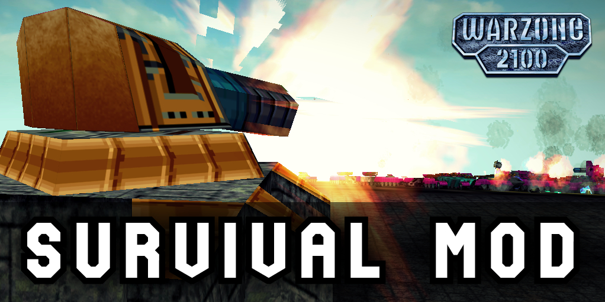

# SurvivalMod
- How long can you survive?
- Cooperative team game
- An endless wave of enemies will spawn on the edge of the map
- Experience gain disabled (no ranks)
- Saving/loading not supported yet
- Make Player 0 the enemy AI

## Overlays
Each directory in [WZmodSurvival/overlays/](/overlays/) represents a variant of the Survival Mod. These directories contain files that override the ones in [WZmodSurvival/mod/](/mod/). The workflow in [WZmodSurvival/.github/workflows/ci.yml](/.github/workflows/ci.yml) will automatically build each overlay.

## License
SPDX-License-Identifier: GPL-2.0-or-later

This program is free software; you can redistribute it and/or modify
it under the terms of the GNU General Public License as published by
the Free Software Foundation; either version 2 of the License, or
(at your option) any later version.

This program is distributed in the hope that it will be useful,
but WITHOUT ANY WARRANTY; without even the implied warranty of
MERCHANTABILITY or FITNESS FOR A PARTICULAR PURPOSE.  See the
GNU General Public License for more details.

You should have received a copy of the GNU General Public License along
with this program; if not, see https://www.gnu.org/licenses/.
